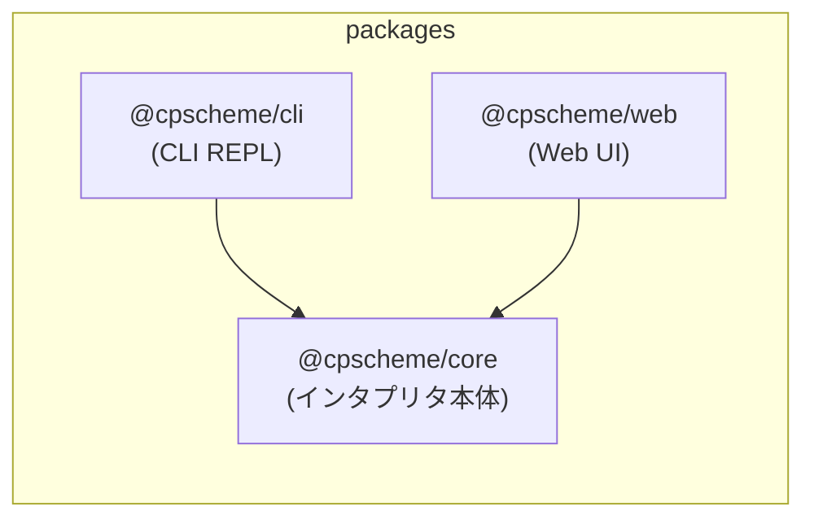

# cpscheme

[](https://github.com/suchi/cpschueme/actions/workflows/ci.yml)

GitHub Copilot が TypeScript で構築した R5RS 準拠の Scheme インタプリタです。

## 全体アーキテクチャ



## 主な機能

- R5RS 完全準拠: `lambda`, `define`, `let`/`let*`/`letrec`, `cond`, `case`, `do`, `quasiquote` 他
- `syntax-rules` マクロシステム（省略記号 `...` 対応）
- 末尾呼び出し最適化（TCO）— トランポリン方式による深い再帰のサポート
- エスケープ継続（`call/cc`）
- 多値返却（`values`, `call-with-values`）
- 文字列ポート（`open-input-string`, `open-output-string`）
- CLI REPL（Node.js）
- Web UI（Vite + React）
- 147 件以上のユニットテスト

## クイックスタート

```bash
npm install
npm run build
npm test --workspace packages/core  # テスト実行（147件）
npm run dev:web                      # Web UI 起動 → http://localhost:5173

# CLI の例
node packages/cli/dist/index.js                          # 対話 REPL
node packages/cli/dist/index.js examples/21-practical.scm  # サンプル実行
node packages/cli/dist/index.js -e "(+ 1 2)"             # 式を評価
node packages/cli/dist/index.js --help                   # ヘルプ表示
```

## ドキュメント

- [作業範囲定義書（SOW）](docs/SOW.md)
- [開発者向けオンボーディングガイド](docs/ONBOARDING.md)
- [チュートリアル（104 サンプル）](docs/TUTORIAL.md)
- [R5RS 対応状況](docs/R5RS-STATUS.md)
- [サンプルプログラム集](examples/README.md)
- [アーキテクチャ決定記録（ADR）](docs/adr/)

## 技術スタック

| ツール | 役割 |
|---|---|
| **TypeScript** (strict) | 実装言語 |
| **Vite** | Web バンドラー |
| **Vitest** | ユニットテスト |
| **Biome** | リンター・フォーマッター |
| **React** | Web UI フレームワーク |
