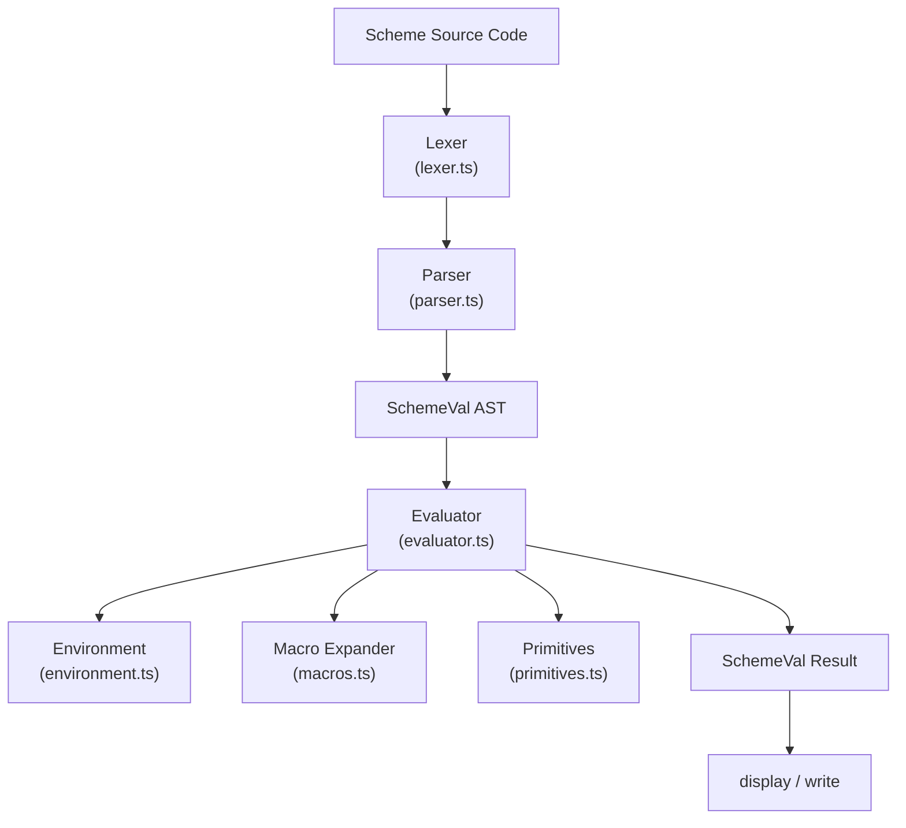

# Developer Onboarding Guide

Welcome to **cpscheme** — a TypeScript implementation of an R5RS-compliant Scheme interpreter.

## Prerequisites

| Tool | Version | Notes |
|---|---|---|
| Node.js | 20 LTS | Required |
| npm | 10+ | Bundled with Node.js 20 |
| Git | any | |

## Quick Start

### 1. Clone and Install

```bash
git clone https://github.com/suchi/cpschueme.git
cd cpschueme
npm install
```

### 2. Run Tests

```bash
npm test --workspace packages/core
```

Expected output: all 147+ tests pass.

### 3. Start the Web UI

```bash
npm run dev:web
```

Open `http://localhost:5173` in your browser. You will see a Scheme REPL web interface.

### 4. Start the CLI REPL

```bash
# Build first
npm run build

# Run the REPL
node packages/cli/dist/index.js
```

## Project Structure

```
cpschueme/
├── .editorconfig           # Editor settings
├── .gitignore
├── biome.json              # Linter/formatter config (root)
├── package.json            # npm workspace root
├── tsconfig.base.json      # Shared TypeScript config
├── docs/
│   ├── SOW.md              # Statement of Work
│   ├── ONBOARDING.md       # This file
│   └── adr/                # Architecture Decision Records
│       ├── 0001-use-typescript.md
│       ├── 0002-use-vite-vitest-biome.md
│       ├── 0003-r5rs-compliance.md
│       └── 0004-monorepo-structure.md
├── packages/
│   ├── core/               # Scheme interpreter library
│   │   ├── src/
│   │   │   ├── types.ts        # SchemeVal type definitions
│   │   │   ├── lexer.ts        # Tokenizer
│   │   │   ├── parser.ts       # S-expression parser
│   │   │   ├── environment.ts  # Lexical environment
│   │   │   ├── evaluator.ts    # Evaluator (TCO via trampoline)
│   │   │   ├── macros.ts       # syntax-rules macro transformer
│   │   │   ├── primitives.ts   # R5RS built-in procedures
│   │   │   ├── port.ts         # I/O ports (string ports)
│   │   │   ├── interpreter.ts  # High-level Interpreter class
│   │   │   └── index.ts        # Public API exports
│   │   ├── stdlib/
│   │   │   └── init.scm        # Standard library in Scheme
│   │   └── tests/
│   │       ├── lexer.test.ts
│   │       ├── parser.test.ts
│   │       ├── evaluator.test.ts
│   │       └── r5rs.test.ts
│   ├── cli/                # CLI REPL (Node.js)
│   │   └── src/
│   │       └── index.ts
│   └── web/                # Web UI (Vite + React)
│       ├── index.html
│       └── src/
│           ├── main.ts
│           └── App.tsx
└── .github/
    └── workflows/
        ├── ci.yml          # CI: lint, test, build
        └── release.yml     # Release: GitHub Releases
```

## Available Commands

| Command | Description |
|---|---|
| `npm install` | Install all dependencies |
| `npm test --workspace packages/core` | Run Scheme interpreter tests |
| `npm run lint` | Lint all TypeScript files with Biome |
| `npm run lint:fix` | Auto-fix linting issues |
| `npm run build` | Build all packages |
| `npm run dev:web` | Start web UI dev server |
| `npm run dev:cli` | Run CLI in development mode |

## Architecture Overview



### Key Concepts

#### SchemeVal

All Scheme values are represented as a TypeScript discriminated union:

```typescript
type SchemeVal =
  | { type: "pair"; car: SchemeVal; cdr: SchemeVal }
  | { type: "null" }
  | { type: "boolean"; value: boolean }
  | { type: "number"; value: number; exact: boolean }
  | { type: "string"; value: string }
  | { type: "symbol"; name: string }
  // ... and more
```

TypeScript's exhaustiveness checking ensures all cases are handled.

#### Tail Call Optimization (TCO)

R5RS requires proper tail calls. We implement this with a **trampoline**:

```typescript
// evaluator.ts
function evalTCO(expr: SchemeVal, env: Environment): SchemeVal {
  let current = { expr, env };
  while (true) {
    const result = evalStep(current.expr, current.env);
    if (result.type === "tail-call") {
      current = { expr: result.expr, env: result.env };
    } else {
      return result;
    }
  }
}
```

This allows Scheme programs with deep tail recursion to run without stack overflow.

#### Macros (syntax-rules)

`syntax-rules` macros are implemented as a pattern-matching / template-expansion system:

```scheme
(define-syntax my-and
  (syntax-rules ()
    ((my-and) #t)
    ((my-and e) e)
    ((my-and e1 e2 ...)
     (if e1 (my-and e2 ...) #f))))
```

The macro transformer lives in `macros.ts` and handles ellipsis (`...`) patterns.

## Development Workflow

1. Create a feature branch: `git checkout -b feature/my-feature`
2. Make changes
3. Run tests: `npm test --workspace packages/core`
4. Lint: `npm run lint`
5. Commit with clear English messages
6. Open a PR

## Testing

Tests are in `packages/core/tests/`. Run them with:

```bash
cd packages/core
npx vitest run
# or in watch mode:
npx vitest
```

### Test Files

| File | What it tests |
|---|---|
| `lexer.test.ts` | Tokenization of Scheme source |
| `parser.test.ts` | S-expression parsing |
| `evaluator.test.ts` | Core evaluation (lambda, define, macros, TCO, call/cc) |
| `r5rs.test.ts` | R5RS compliance (standard procedures, tail calls) |

## Adding a New Built-in Procedure

1. Open `packages/core/src/primitives.ts`
2. Add your procedure to the `makePrimitives()` function:

```typescript
prims.set("my-proc", {
  type: "primitive",
  name: "my-proc",
  fn: (args) => {
    if (args.length !== 1) throw new SchemeError("my-proc: expected 1 argument");
    // ... implementation
    return makeNumber(42);
  },
});
```

3. Add a test in `packages/core/tests/r5rs.test.ts`

## Adding a Standard Library Procedure in Scheme

If the procedure can be expressed in Scheme, add it to `packages/core/stdlib/init.scm`:

```scheme
(define (my-proc x)
  (* x 2))
```

This is loaded automatically when the interpreter starts.

## CI/CD

- **CI** runs on every push and PR: lint → test → build
- **Release** runs on version tags (`v*.*.*`): creates a GitHub Release

See `.github/workflows/` for details.

## Troubleshooting

### `Cannot find module '@cpscheme/core'`

Run `npm install` from the project root to link workspace packages.

### Tests fail after adding a new feature

Check `packages/core/tests/` for related tests. Run `npx vitest run --reporter verbose` for detailed output.

### Web UI shows blank page

Run `npm run build` first to make sure there are no TypeScript errors.
