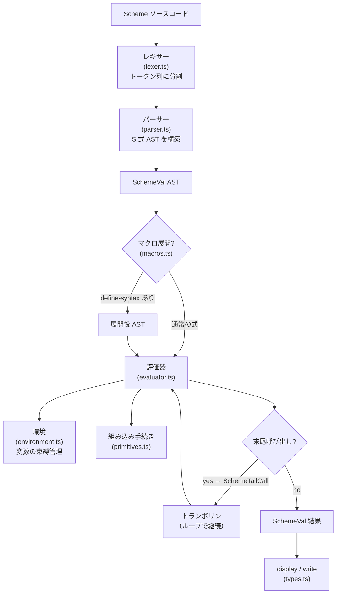
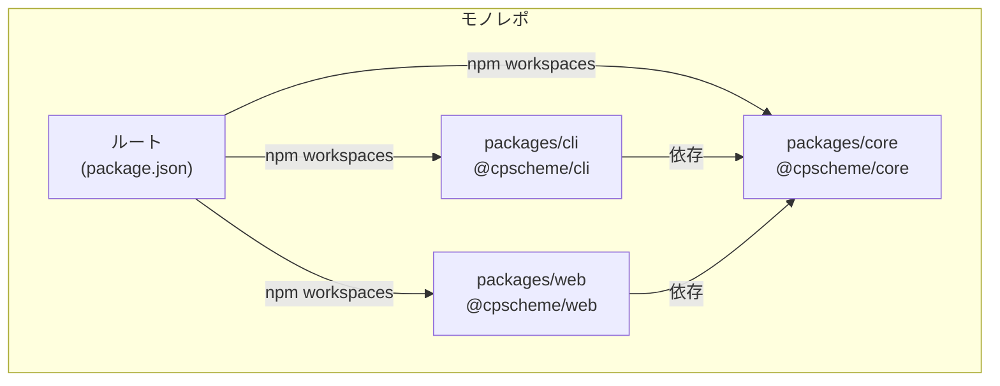
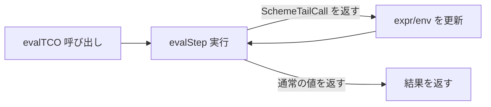
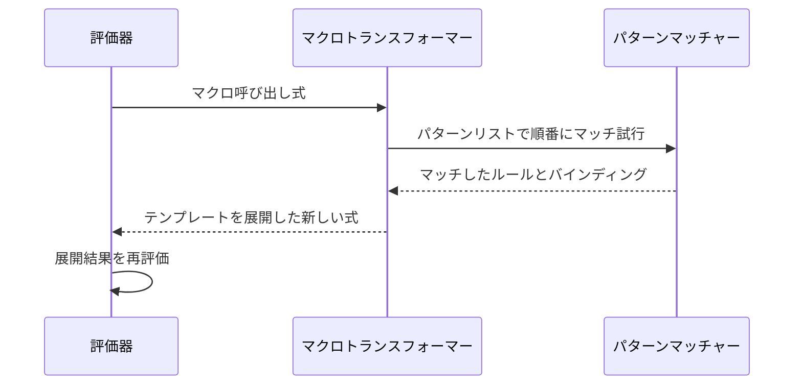
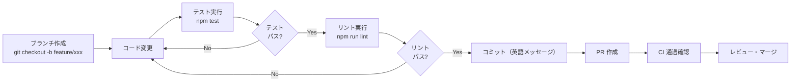
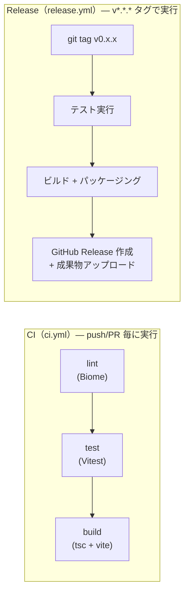

# 開発者向けオンボーディングガイド

**cpscheme** へようこそ — TypeScript 製 R5RS 準拠 Scheme インタプリタです。

## 前提条件

| ツール | バージョン | 備考 |
|---|---|---|
| Node.js | 20 LTS | 必須 |
| npm | 10 以上 | Node.js 20 に同梱 |
| Git | 任意 | |

## クイックスタート

### 1. クローンとインストール

```bash
git clone https://github.com/suchi/cpschueme.git
cd cpschueme
npm install
```

### 2. テスト実行

```bash
npm test --workspace packages/core
```

期待出力: 147 件以上のテストがすべてパスする。

### 3. Web UI の起動

```bash
npm run dev:web
```

ブラウザで `http://localhost:5173` を開くと、Scheme REPL の Web インターフェースが表示されます。

### 4. CLI REPL の起動

```bash
# まずビルド
npm run build

# REPL 起動
node packages/cli/dist/index.js
```

## プロジェクト構造

```
cpschueme/
├── .editorconfig           # エディター設定
├── .gitignore
├── biome.json              # リンター・フォーマッター設定（ルート）
├── package.json            # npm workspace ルート
├── tsconfig.base.json      # 共有 TypeScript 設定
├── docs/
│   ├── SOW.md              # 作業範囲定義書
│   ├── ONBOARDING.md       # 本ドキュメント
│   └── adr/                # アーキテクチャ決定記録
│       ├── 0001-use-typescript.md
│       ├── 0002-use-vite-vitest-biome.md
│       ├── 0003-r5rs-compliance.md
│       └── 0004-monorepo-structure.md
├── packages/
│   ├── core/               # Scheme インタプリタライブラリ
│   │   ├── src/
│   │   │   ├── types.ts        # SchemeVal 型定義
│   │   │   ├── lexer.ts        # トークナイザー
│   │   │   ├── parser.ts       # S 式パーサー
│   │   │   ├── environment.ts  # 字句環境
│   │   │   ├── evaluator.ts    # 評価器（TCO: トランポリン方式）
│   │   │   ├── macros.ts       # syntax-rules マクロトランスフォーマー
│   │   │   ├── primitives.ts   # R5RS 組み込み手続き
│   │   │   ├── port.ts         # I/O ポート（文字列ポート）
│   │   │   ├── interpreter.ts  # 高レベル Interpreter クラス
│   │   │   └── index.ts        # 公開 API エクスポート
│   │   ├── stdlib/
│   │   │   └── init.scm        # Scheme で書かれた標準ライブラリ
│   │   └── tests/
│   │       ├── lexer.test.ts
│   │       ├── parser.test.ts
│   │       ├── evaluator.test.ts
│   │       └── r5rs.test.ts
│   ├── cli/                # CLI REPL（Node.js）
│   │   └── src/
│   │       └── index.ts
│   └── web/                # Web UI（Vite + React）
│       ├── index.html
│       └── src/
│           ├── main.tsx
│           └── App.tsx
└── .github/
    └── workflows/
        ├── ci.yml          # CI: lint・テスト・ビルド
        └── release.yml     # リリース: GitHub Releases
```

## 利用可能なコマンド

| コマンド | 説明 |
|---|---|
| `npm install` | 全依存パッケージをインストール |
| `npm test --workspace packages/core` | Scheme インタプリタのテストを実行 |
| `npm run lint` | Biome で全 TypeScript ファイルをリント |
| `npm run lint:fix` | リント問題を自動修正 |
| `npm run build` | 全パッケージをビルド |
| `npm run dev:web` | Web UI 開発サーバーを起動 |
| `npm run dev:cli` | CLI を開発モードで実行 |

## アーキテクチャ概要

### 評価パイプライン



### パッケージ依存関係



### 主要概念

#### SchemeVal — Scheme 値の型表現

すべての Scheme 値は TypeScript の判別共用体で表現されます:

```typescript
type SchemeVal =
  | { type: "pair"; car: SchemeVal; cdr: SchemeVal }   // cons セル
  | { type: "null" }                                    // 空リスト
  | { type: "boolean"; value: boolean }
  | { type: "number"; value: number; exact: boolean }
  | { type: "string"; value: string }
  | { type: "symbol"; name: string }
  | { type: "procedure"; params: ...; body: ...; env: ... }
  | { type: "macro"; transformer: ... }
  // ... 他多数
```

TypeScript の網羅性チェックにより、すべての型ケースが処理されることをコンパイル時に保証します。

#### 末尾呼び出し最適化（TCO）

R5RS は適切な末尾呼び出しを必須としています。**トランポリン**パターンで実装:



```typescript
// evaluator.ts
function evalTCO(expr: SchemeVal, env: Environment): SchemeVal {
  let current = { expr, env };
  while (true) {
    const result = evalStep(current.expr, current.env);
    if (result.type === "tail-call") {
      current = { expr: result.expr, env: result.env };  // スタックを消費しない
    } else {
      return result;
    }
  }
}
```

これにより、深い末尾再帰を持つ Scheme プログラムでもスタックオーバーフローなく動作します。

#### マクロ（syntax-rules）

`syntax-rules` マクロはパターンマッチング・テンプレート展開システムとして実装されています:



```scheme
(define-syntax my-and
  (syntax-rules ()
    ((my-and) #t)
    ((my-and e) e)
    ((my-and e1 e2 ...)        ; 省略記号 ... でパターンマッチ
     (if e1 (my-and e2 ...) #f))))
```

## 開発ワークフロー



## テスト

テストは `packages/core/tests/` にあります。以下のコマンドで実行:

```bash
cd packages/core
npx vitest run
# ウォッチモードの場合:
npx vitest
```

### テストファイル一覧

| ファイル | テスト内容 |
|---|---|
| `lexer.test.ts` | Scheme ソースのトークン化 |
| `parser.test.ts` | S 式解析 |
| `evaluator.test.ts` | コア評価（lambda、define、マクロ、TCO、call/cc） |
| `r5rs.test.ts` | R5RS 準拠（標準手続き、末尾呼び出し） |

## 組み込み手続きの追加方法

1. `packages/core/src/primitives.ts` を開く
2. `makePrimitives()` 関数に手続きを追加:

```typescript
prims.set("my-proc", {
  type: "primitive",
  name: "my-proc",
  fn: (args) => {
    if (args.length !== 1) throw new SchemeError("my-proc: expected 1 argument");
    // ... 実装
    return makeNumber(42);
  },
});
```

3. `packages/core/tests/r5rs.test.ts` にテストを追加

## Scheme による標準ライブラリ手続きの追加方法

Scheme で表現できる手続きは `packages/core/stdlib/init.scm` に追加:

```scheme
(define (my-proc x)
  (* x 2))
```

インタプリタ起動時に自動的に読み込まれます。

## CI/CD



詳細は `.github/workflows/` を参照してください。

## トラブルシューティング

### `Cannot find module '@cpscheme/core'`

プロジェクトルートから `npm install` を実行してワークスペースパッケージをリンクしてください。

### 新機能追加後にテストが失敗する

`packages/core/tests/` の関連テストを確認してください。詳細な出力には `npx vitest run --reporter verbose` を使用してください。

### Web UI が白紙のページを表示する

`npm run build` を実行して TypeScript エラーがないか確認してください。
