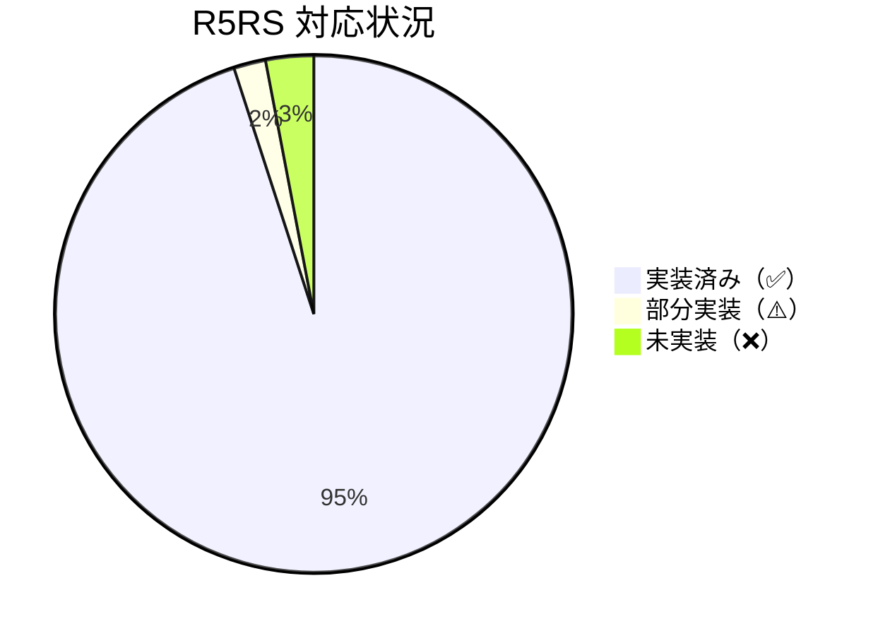

# R5RS 対応状況

cpscheme の R5RS（Revised⁵ Report on the Algorithmic Language Scheme）準拠状況の一覧です。

凡例: ✅ 実装済み・完全動作 / ⚠️ 部分実装 / ❌ 未実装

---

## 特殊形式（Special Forms）

| 形式 | 状態 | 備考 |
|---|---|---|
| `quote` | ✅ | `'x` 糖衣構文も対応 |
| `lambda` | ✅ | 可変長引数 `(lambda (a . rest) ...)` 対応 |
| `if` | ✅ | 2引数・3引数両対応 |
| `cond` | ✅ | `else` 節・`=>` 節対応 |
| `case` | ✅ | `else` 節対応 |
| `and` | ✅ | 短絡評価、末尾位置 TCO |
| `or` | ✅ | 短絡評価、末尾位置 TCO |
| `when` | ✅ | R5RS 拡張（`if` + `begin`） |
| `unless` | ✅ | R5RS 拡張 |
| `define` | ✅ | 変数定義・手続き定義省略形 |
| `set!` | ✅ | 破壊的代入 |
| `begin` | ✅ | 式列、TCO |
| `let` | ✅ | 名前付き `let` 対応 |
| `let*` | ✅ | |
| `letrec` | ✅ | |
| `letrec*` | ✅ | |
| `do` | ✅ | |
| `delay` | ✅ | promise 生成 |
| `force` | ✅ | promise 強制評価 |
| `quasiquote` | ✅ | `` ` `` `,` `,@` 糖衣構文対応 |
| `define-syntax` | ✅ | |
| `let-syntax` | ✅ | |
| `letrec-syntax` | ✅ | |
| `syntax-rules` | ✅ | 省略記号 `...` 対応 |
| `values` | ✅ | |
| `call-with-values` | ✅ | |
| `call-with-current-continuation` | ✅ | エスケープ継続のみ |
| `call/cc` | ✅ | `call-with-current-continuation` の別名 |
| `dynamic-wind` | ✅ | |
| `define-record-type` | ✅ | SRFI-9 / R7RS スタイル |
| `guard` | ✅ | 例外ハンドラー構文 |
| `parameterize` | ✅ | 動的パラメーター |

---

## 数値演算（Numbers）

### 算術手続き

| 手続き | 状態 | 備考 |
|---|---|---|
| `+` `-` `*` `/` | ✅ | 可変長引数 |
| `quotient` | ✅ | |
| `remainder` | ✅ | |
| `modulo` | ✅ | |
| `gcd` | ✅ | |
| `lcm` | ✅ | |
| `abs` | ✅ | |
| `floor` | ✅ | |
| `ceiling` | ✅ | |
| `truncate` | ✅ | |
| `round` | ✅ | 偶数丸め（banker's rounding） |
| `sqrt` | ✅ | |
| `expt` | ✅ | |
| `min` `max` | ✅ | |
| `sin` `cos` `tan` | ✅ | |
| `asin` `acos` `atan` | ✅ | `(atan y x)` 2引数形式対応 |
| `exp` `log` | ✅ | |
| `number->string` | ✅ | 基数指定対応（2〜36） |
| `string->number` | ✅ | 基数指定対応 |
| `exact->inexact` | ✅ | `inexact` 別名あり |
| `inexact->exact` | ✅ | `exact` 別名あり |

### 数値述語

| 手続き | 状態 | 備考 |
|---|---|---|
| `number?` | ✅ | |
| `complex?` `real?` `rational?` `integer?` | ✅ | 数値塔は浮動小数点で近似 |
| `exact?` `inexact?` | ✅ | |
| `zero?` `positive?` `negative?` | ✅ | |
| `odd?` `even?` | ✅ | |
| `finite?` `infinite?` `nan?` | ✅ | R7RS 拡張 |

### 数値比較

| 手続き | 状態 | 備考 |
|---|---|---|
| `=` `<` `>` `<=` `>=` | ✅ | 可変長引数 |

---

## 真偽値（Booleans）

| 手続き | 状態 | 備考 |
|---|---|---|
| `not` | ✅ | |
| `boolean?` | ✅ | |
| `boolean=?` | ✅ | |

---

## ペア・リスト（Pairs and Lists）

| 手続き | 状態 | 備考 |
|---|---|---|
| `cons` `car` `cdr` | ✅ | |
| `set-car!` `set-cdr!` | ✅ | 破壊的変更 |
| `caar` `cadr` `cdar` `cddr` | ✅ | |
| `caaar`〜`cdddr`（3段） | ✅ | |
| `caaaar`〜`cddddr`（4段） | ✅ | |
| `null?` `pair?` `list?` | ✅ | |
| `list` | ✅ | |
| `length` | ✅ | |
| `append` | ✅ | |
| `reverse` | ✅ | |
| `list-tail` | ✅ | |
| `list-ref` | ✅ | |
| `list-copy` | ✅ | |
| `member` | ✅ | `equal?` で比較 |
| `memq` | ✅ | `eq?` で比較 |
| `memv` | ✅ | `eqv?` で比較 |
| `assoc` | ✅ | |
| `assq` | ✅ | |
| `assv` | ✅ | |
| `map` | ✅ | 複数リスト対応 |
| `for-each` | ✅ | 複数リスト対応 |
| `filter` | ✅ | stdlib |
| `fold-left` / `fold-right` | ✅ | stdlib |
| `reduce` | ✅ | stdlib |
| `flatten` | ✅ | stdlib |
| `iota` | ✅ | stdlib（`(iota count)` / `(iota count start)`）|

---

## 記号（Symbols）

| 手続き | 状態 | 備考 |
|---|---|---|
| `symbol?` | ✅ | |
| `symbol->string` | ✅ | |
| `string->symbol` | ✅ | |
| `gensym` | ✅ | 一意なシンボル生成 |

---

## 文字（Characters）

| 手続き | 状態 | 備考 |
|---|---|---|
| `char?` | ✅ | |
| `char->integer` `integer->char` | ✅ | |
| `char=?` `char<?` `char>?` `char<=?` `char>=?` | ✅ | |
| `char-ci=?` `char-ci<?` 等 | ✅ | |
| `char-alphabetic?` `char-numeric?` `char-whitespace?` | ✅ | |
| `char-upper-case?` `char-lower-case?` | ✅ | |
| `char-upcase` `char-downcase` | ✅ | |

---

## 文字列（Strings）

| 手続き | 状態 | 備考 |
|---|---|---|
| `string?` | ✅ | |
| `make-string` | ✅ | |
| `string` | ✅ | 文字の可変長リストから作成 |
| `string-length` | ✅ | |
| `string-ref` | ✅ | |
| `string-set!` | ✅ | |
| `string=?` `string<?` `string>?` `string<=?` `string>=?` | ✅ | |
| `string-ci=?` 等 | ✅ | |
| `substring` | ✅ | |
| `string-append` | ✅ | |
| `string->list` `list->string` | ✅ | |
| `string-copy` | ✅ | |
| `string-fill!` | ✅ | |
| `string-upcase` `string-downcase` | ✅ | |
| `number->string` `string->number` | ✅ | |
| `string-contains` | ✅ | 拡張 |
| `string-split` | ✅ | 拡張 |
| `string-join` | ✅ | 拡張 |
| `string-map` | ✅ | |
| `string-for-each` | ✅ | |

---

## ベクター（Vectors）

| 手続き | 状態 | 備考 |
|---|---|---|
| `vector?` | ✅ | |
| `make-vector` | ✅ | |
| `vector` | ✅ | |
| `vector-length` | ✅ | |
| `vector-ref` | ✅ | |
| `vector-set!` | ✅ | |
| `vector->list` `list->vector` | ✅ | |
| `vector-fill!` | ✅ | |
| `vector-copy` | ✅ | |
| `vector-append` | ✅ | |
| `vector-map` | ✅ | |
| `vector-for-each` | ✅ | |

---

## 制御構造（Control）

| 手続き | 状態 | 備考 |
|---|---|---|
| `apply` | ✅ | |
| `call-with-current-continuation` / `call/cc` | ✅ | エスケープ継続 |
| `values` | ✅ | |
| `call-with-values` | ✅ | |
| `dynamic-wind` | ✅ | |
| `procedure?` | ✅ | |

---

## 入出力（Input / Output）

| 手続き | 状態 | 備考 |
|---|---|---|
| `display` | ✅ | ポート引数対応 |
| `write` | ✅ | ポート引数対応 |
| `newline` | ✅ | |
| `write-char` | ✅ | |
| `write-string` | ✅ | |
| `read` | ✅ | 文字列ポートから S 式読み込み |
| `read-char` | ✅ | |
| `peek-char` | ✅ | |
| `read-line` | ✅ | |
| `char-ready?` | ✅ | 常に `#t` を返す |
| `eof-object?` | ✅ | |
| `eof-object` | ✅ | |
| `open-input-string` | ✅ | |
| `open-output-string` | ✅ | |
| `get-output-string` | ✅ | |
| `with-input-from-string` | ✅ | |
| `with-output-to-string` | ✅ | |
| `current-input-port` | ✅ | |
| `current-output-port` | ✅ | |
| `current-error-port` | ✅ | |
| `port?` `input-port?` `output-port?` | ✅ | |
| `port-open?` | ✅ | |
| `close-input-port` `close-output-port` `close-port` | ✅ | |
| `open-input-file` `open-output-file` | ❌ | ファイル I/O は未実装 |

---

## 例外処理（Exceptions）

| 手続き / 形式 | 状態 | 備考 |
|---|---|---|
| `error` | ✅ | |
| `with-exception-handler` | ✅ | |
| `raise` | ✅ | |
| `raise-continuable` | ✅ | |
| `guard` | ✅ | |
| `error-message` | ✅ | |
| `error-object?` | ✅ | |

---

## 同一性・等価性（Equivalence）

| 手続き | 状態 | 備考 |
|---|---|---|
| `eq?` | ✅ | 同一オブジェクト比較 |
| `eqv?` | ✅ | |
| `equal?` | ✅ | 深い構造比較 |

---

## レコード型（Record Types）

| 形式 | 状態 | 備考 |
|---|---|---|
| `define-record-type` | ✅ | SRFI-9 / R7RS スタイル |

---

## 動的パラメーター（Dynamic Parameters）

| 手続き / 形式 | 状態 | 備考 |
|---|---|---|
| `make-parameter` | ✅ | |
| `parameterize` | ✅ | |

---

## 未実装機能（今後の予定）

| 機能 | 備考 |
|---|---|
| ファイル I/O（`open-input-file` 等） | ブラウザー互換性のため未実装 |
| 完全継続（multi-shot `call/cc`） | 現在はエスケープ継続のみ |
| 数値塔（真の有理数・多倍長整数） | IEEE 754 倍精度のみ |
| R7RS モジュールシステム | 将来フェーズ |
| 末尾再帰の `named let` 以外のコンテキスト | ほぼ対応済み |

---

## まとめ

cpscheme は R5RS の主要な機能をほぼ完全に実装しており、実用的な Scheme プログラムを動かすのに十分な対応状況です。
