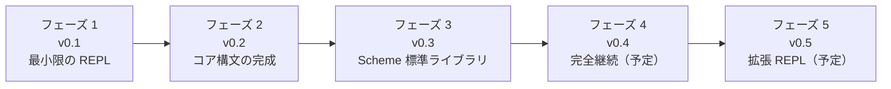

# 作業範囲定義書（SOW）

## プロジェクト名

**sucheme-ts** — TypeScript 製 R5RS 準拠 Scheme インタプリタ

## 概要

TypeScript で R5RS 完全準拠の Scheme インタプリタを構築します。CLI REPL、Web ベース UI、包括的な標準ライブラリを含め、3フェーズで段階的に開発します。

## 目標

1. R5RS に完全準拠した動作する Scheme インタプリタを提供する
2. CLI（REPL）と Web UI の両方のインターフェースを提供する
3. Vitest による自動テストで正確性を保証する
4. Biome と TypeScript strict モードによる静的解析でコード品質を維持する
5. GitHub Actions と GitHub Releases で CI/CD を自動化する

## 開発フェーズ全体図

## スコープ

### 対象（スコープ内）

- **レキサー**: Scheme ソースをトークンに分割
- **パーサー**: トークンを S 式 AST に変換
- **評価器**: 末尾呼び出し最適化（TCO）付きツリーウォーキング評価器
- **マクロシステム**: `syntax-rules`, `define-syntax`, `let-syntax`, `letrec-syntax`
- **標準ライブラリ**: R5RS 手続き全体（TypeScript 実装 + Scheme 実装の混在）
- **call/cc**: エスケープ継続
- **多値**: `values`, `call-with-values`
- **ポート**: 文字列ポート（`open-input-string`, `open-output-string`）
- **CLI REPL**: Node.js readline ベースの REPL
- **Web UI**: Vite + React ブラウザー REPL
- **テスト**: レキサー・パーサー・評価器・R5RS 準拠のユニットテスト
- **CI/CD**: lint・テスト・ビルド・リリース用 GitHub Actions ワークフロー
- **ドキュメント**: SOW、ADR、オンボーディングガイド

### 対象外（スコープ外・初期）

- 完全継続（フェーズ 1〜3 はエスケープ継続のみ）
- REPL の複数行編集（後フェーズに延期）
- REPL の Emacs キーバインド（後フェーズに延期）
- ファイル I/O（ファイルの読み書き）
- 数値塔（現在は IEEE 754 倍精度のみ）
- モジュール / R7RS ライブラリ

### 将来フェーズ

- **フェーズ 4**: 完全継続、全コンテキストでの真の末尾再帰
- **フェーズ 5**: Emacs キーバインド付き複数行 REPL 編集
- **フェーズ 6**: 数値塔（真の有理数、多倍長整数）
- **フェーズ 7**: R7RS 互換レイヤー

## 成果物

| 成果物 | 説明 |
|---|---|
| `packages/core` | TypeScript 製 Scheme インタプリタライブラリ |
| `packages/cli` | CLI REPL バイナリ |
| `packages/web` | Web UI（Vite + React） |
| `docs/SOW.md` | 本ドキュメント |
| `docs/ONBOARDING.md` | 開発者向けオンボーディングガイド |
| `docs/adr/*.md` | アーキテクチャ決定記録 |
| `.github/workflows/ci.yml` | CI ワークフロー（lint・テスト・ビルド） |
| `.github/workflows/release.yml` | リリースワークフロー（GitHub Releases） |

## 開発フェーズ詳細

### フェーズ 1: 最小限の REPL（v0.1）

**目標**: 基本的な Scheme 式を評価できる動作する REPL を実現する。

- [x] プロジェクト基盤構築（npm workspaces、TypeScript、Biome、Vitest、Vite）
- [x] レキサー（トークン化）
- [x] パーサー（S 式解析）
- [x] コア評価器（lambda、define、if、begin、quote）
- [x] 基本算術・リスト操作
- [x] CLI REPL
- [x] 基本 Web UI
- [x] ユニットテスト

### フェーズ 2: コア Scheme 構文（v0.2）

**目標**: R5RS 特殊形式と標準手続きを完成させる。

- [x] `let`, `let*`, `letrec`, 名前付き `let`
- [x] `cond`, `case`, `when`, `unless`, `and`, `or`
- [x] `do` ループ
- [x] `quasiquote`, `unquote`, `unquote-splicing`
- [x] `define-syntax`, `syntax-rules`（省略記号 `...` 対応）
- [x] `call-with-current-continuation`（エスケープ継続）
- [x] `values`, `call-with-values`
- [x] 文字列・文字・ベクター操作手続き完全実装
- [x] 文字列ポート

### フェーズ 3: Scheme による Scheme 標準ライブラリ（v0.3）

**目標**: 標準ライブラリをできる限り Scheme 自体で実装する。

- [x] `stdlib/init.scm` — Scheme レベルの標準ライブラリ
- [x] Scheme による `map`, `for-each`, `filter`, `reduce`
- [x] 数値述語（`zero?`, `positive?`, `negative?`, `odd?`, `even?`）
- [x] `c[ad]{2,4}r` ヘルパー

## 技術スタック

| ツール | バージョン | 用途 |
|---|---|---|
| TypeScript | ^5.7 | 主要言語 |
| Vite | ^6.1 | Web バンドラー・開発サーバー |
| Vitest | ^3.0 | ユニットテストフレームワーク |
| Biome | ^1.9 | リンター・フォーマッター |
| React | ^18.3 | Web UI フレームワーク |
| Node.js | 20 LTS | CLI ランタイム |

## マイルストーン

| マイルストーン | 対象 | 状態 |
|---|---|---|
| v0.1 — 最小限の REPL | フェーズ 1 | ✅ 完了 |
| v0.2 — コア Scheme | フェーズ 2 | ✅ 完了 |
| v0.3 — Scheme 標準ライブラリ | フェーズ 3 | ✅ 完了 |
| v0.4 — 完全継続 | 未定 | ⬜ 計画中 |
| v0.5 — 拡張 REPL | 未定 | ⬜ 計画中 |

## 受け入れ基準

- Vitest テスト 147 件以上がすべてパスすること
- `npm run build` が全パッケージで成功すること
- Web UI が起動し、基本的な Scheme 式を実行できること
- CLI REPL が起動し、対話的に式を評価できること
- R5RS 準拠: 末尾呼び出し、`let` 系フォーム、マクロ、`call/cc`
- CI パイプラインが全 PR でパスすること
