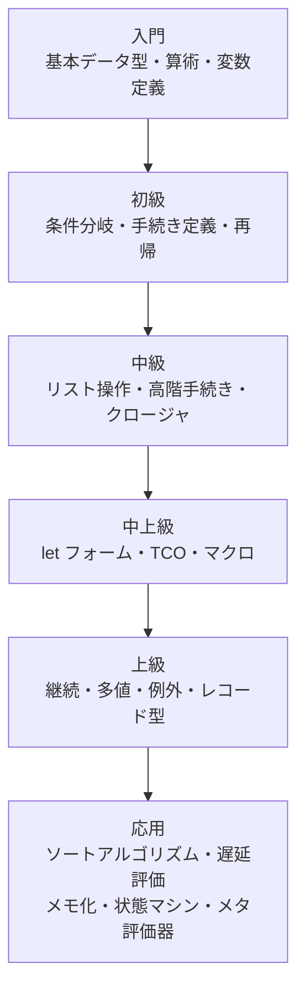

# sucheme-ts チュートリアル

このドキュメントは、sucheme-ts（TypeScript 製 R5RS 準拠 Scheme インタプリタ）を使って Scheme プログラミングを学ぶためのガイドです。基本から応用まで、100 以上のサンプルプログラムを通して学べます。

## 目次

1. [実行環境の準備](#1-実行環境の準備)
2. [基本データ型](#2-基本データ型)
3. [算術演算](#3-算術演算)
4. [変数の定義](#4-変数の定義)
5. [条件分岐](#5-条件分岐)
6. [手続きの定義](#6-手続きの定義)
7. [再帰](#7-再帰)
8. [ペアとリスト](#8-ペアとリスト)
9. [高階手続き](#9-高階手続き)
10. [let フォーム](#10-let-フォーム)
11. [末尾再帰・名前付き let](#11-末尾再帰名前付き-let)
12. [クォートとリスト操作](#12-クォートとリスト操作)
13. [do ループ](#13-do-ループ)
14. [文字・文字列](#14-文字文字列)
15. [ベクター](#15-ベクター)
16. [マクロ（syntax-rules）](#16-マクロsyntax-rules)
17. [継続（call/cc）](#17-継続callcc)
18. [多値](#18-多値)
19. [例外処理](#19-例外処理)
20. [レコード型](#20-レコード型)
21. [入出力とポート](#21-入出力とポート)
22. [実用プログラム例](#22-実用プログラム例)

---

## 1. 実行環境の準備

sucheme-ts は2つの方法で実行できます。

### Web UI で実行

```bash
npm run dev:web
# ブラウザで http://localhost:5173 を開く
```

### CLI REPL で実行

```bash
npm run build
node packages/cli/dist/index.js
```

REPL では `Enter` で式を評価し、`Ctrl+C` または `(exit)` で終了します。

---

## 2. 基本データ型

### サンプル 001: 数値

```scheme
; 整数
42
-7
0

; 浮動小数点数
3.14
-2.718
1.0e10

; 特別な数値
+inf.0   ; 正の無限大
-inf.0   ; 負の無限大
+nan.0   ; Not a Number
```

### サンプル 002: 真偽値

```scheme
#t  ; 真（true）
#f  ; 偽（false）

; #f だけが偽。それ以外はすべて真
(if 0 "zero is true" "false")    ; => "zero is true"
(if "" "empty string is true" "false")  ; => "empty string is true"
(if '() "null list is true" "false")    ; => "null list is true"
```

### サンプル 003: 文字列

```scheme
"hello"
"world"
"日本語もOK"

; 文字列の基本操作
(string-length "hello")     ; => 5
(string-append "hello" " " "world")  ; => "hello world"
(substring "hello" 1 3)     ; => "el"
```

### サンプル 004: 文字

```scheme
#\a      ; 文字 a
#\space  ; スペース
#\newline ; 改行
#\0      ; 文字 0（ゼロ）

(char->integer #\a)   ; => 97
(integer->char 65)    ; => #\A
```

### サンプル 005: シンボル

```scheme
hello          ; シンボル hello
my-variable    ; ハイフン区切りのシンボル（慣例）
string->number ; 変換手続きの命名慣例

(symbol? 'hello)  ; => #t
(symbol->string 'hello)  ; => "hello"
(string->symbol "world") ; => world
```

### サンプル 006: リスト（ペア）

```scheme
'(1 2 3)        ; リスト
'(a b c)        ; シンボルのリスト
'()             ; 空リスト（null）
'(1 (2 3) 4)   ; 入れ子リスト

(pair? '(1 2))  ; => #t
(null? '())     ; => #t
(list? '(1 2))  ; => #t
```

### サンプル 007: ベクター

```scheme
#(1 2 3)          ; 定数ベクター
(vector 1 2 3)    ; ベクターの作成

(vector-ref #(10 20 30) 1)   ; => 20
(vector-length #(1 2 3))     ; => 3
```

---

## 3. 算術演算

### サンプル 008: 四則演算

```scheme
(+ 1 2 3 4 5)   ; => 15（可変長引数）
(- 10 3)        ; => 7
(* 2 3 4)       ; => 24
(/ 10 2)        ; => 5
(/ 1 3)         ; => 0.3333...（浮動小数点に変換）
```

### サンプル 009: 整数演算

```scheme
(quotient 10 3)   ; => 3（商）
(remainder 10 3)  ; => 1（余り）
(modulo 10 3)     ; => 1
(modulo -10 3)    ; => 2（常に除数と同符号）
(remainder -10 3) ; => -1（常に被除数と同符号）
```

### サンプル 010: 数学関数

```scheme
(abs -5)          ; => 5
(sqrt 9)          ; => 3
(expt 2 10)       ; => 1024
(floor 3.7)       ; => 3
(ceiling 3.2)     ; => 4
(round 3.5)       ; => 4（偶数丸め）
(round 2.5)       ; => 2（偶数丸め）
(truncate -3.7)   ; => -3
```

### サンプル 011: gcd と lcm

```scheme
(gcd 12 8)        ; => 4
(gcd 12 8 6)      ; => 2（可変長）
(lcm 4 6)         ; => 12
(lcm 4 6 10)      ; => 60
```

### サンプル 012: 三角関数

```scheme
(sin 0)           ; => 0.0
(cos 0)           ; => 1.0
(tan 0)           ; => 0.0
(asin 1.0)        ; => 1.5707...（π/2）
(atan 1 1)        ; => 0.7853...（π/4）
```

### サンプル 013: 数値変換

```scheme
(exact->inexact 1/3)   ; => 0.3333... （分数はIEEE浮動小数で近似）
(inexact->exact 0.5)   ; => 1 （近似整数）
(number->string 255 16)  ; => "ff"（16進数）
(number->string 10 2)    ; => "1010"（2進数）
(string->number "ff" 16) ; => 255
(string->number "1010" 2); => 10
```

### サンプル 014: 数値述語

```scheme
(zero? 0)       ; => #t
(positive? 5)   ; => #t
(negative? -3)  ; => #t
(odd? 7)        ; => #t
(even? 4)       ; => #t
(integer? 3.0)  ; => #t（整数値の浮動小数点）
(exact? 3)      ; => #t
(inexact? 3.0)  ; => #t
```

---

## 4. 変数の定義

### サンプル 015: define による変数定義

```scheme
(define x 42)
(define pi 3.14159)
(define greeting "Hello, World!")

x         ; => 42
pi        ; => 3.14159
greeting  ; => "Hello, World!"
```

### サンプル 016: set! による再代入

```scheme
(define counter 0)
(set! counter 1)
(set! counter (+ counter 1))
counter   ; => 2
```

---

## 5. 条件分岐

### サンプル 017: if

```scheme
; (if 条件 真の式 偽の式)
(if (> 3 2) "yes" "no")     ; => "yes"
(if #f "true" "false")      ; => "false"

; else 節なしの場合は void を返す
(if #f "never executed")    ; => (void)
```

### サンプル 018: cond

```scheme
(define (grade score)
  (cond
    ((>= score 90) "A")
    ((>= score 80) "B")
    ((>= score 70) "C")
    ((>= score 60) "D")
    (else "F")))

(grade 85)  ; => "B"
(grade 72)  ; => "C"
(grade 50)  ; => "F"
```

### サンプル 019: case

```scheme
(define (day-name n)
  (case n
    ((1) "Monday")
    ((2) "Tuesday")
    ((3) "Wednesday")
    ((4) "Thursday")
    ((5) "Friday")
    ((6 7) "Weekend")  ; 複数値でマッチ
    (else "Unknown")))

(day-name 3)  ; => "Wednesday"
(day-name 6)  ; => "Weekend"
```

### サンプル 020: and と or

```scheme
; and: すべて真なら最後の値を返す
(and 1 2 3)      ; => 3
(and 1 #f 3)     ; => #f（短絡評価）
(and)            ; => #t

; or: 最初の真の値を返す
(or #f #f 42)    ; => 42
(or #f #f #f)    ; => #f
(or)             ; => #f
```

### サンプル 021: when と unless

```scheme
; when: 条件が真のときのみ実行
(when (> 5 3)
  (display "5 > 3")
  (newline))
; 出力: 5 > 3

; unless: 条件が偽のときのみ実行
(unless (> 3 5)
  (display "3 is not > 5")
  (newline))
; 出力: 3 is not > 5
```

---

## 6. 手続きの定義

### サンプル 022: define による手続き定義

```scheme
; (define (名前 引数...) 本体...)
(define (square x)
  (* x x))

(square 5)   ; => 25
(square 12)  ; => 144
```

### サンプル 023: lambda による無名手続き

```scheme
; (lambda (引数...) 本体...)
(define square (lambda (x) (* x x)))

; 即時実行
((lambda (x y) (+ x y)) 3 4)  ; => 7
```

### サンプル 024: 複数の引数

```scheme
(define (add x y) (+ x y))
(define (volume l w h) (* l w h))

(add 3 4)         ; => 7
(volume 2 3 4)    ; => 24
```

### サンプル 025: 可変長引数

```scheme
; . rest で残りの引数をリストで受け取る
(define (sum . numbers)
  (apply + numbers))

(sum 1 2 3 4 5)  ; => 15
(sum)            ; => 0

; 必須引数 + 可変長引数
(define (at-least-two first second . rest)
  (list first second rest))

(at-least-two 1 2 3 4 5)  ; => (1 2 (3 4 5))
```

### サンプル 026: 複数の式（begin）

```scheme
(define (print-and-square x)
  (display "Squaring: ")
  (display x)
  (newline)
  (* x x))

(print-and-square 5)
; 出力:
; Squaring: 5
; => 25
```

---

## 7. 再帰

### サンプル 027: 階乗（基本的な再帰）

```scheme
(define (factorial n)
  (if (= n 0)
      1
      (* n (factorial (- n 1)))))

(factorial 5)   ; => 120
(factorial 10)  ; => 3628800
```

### サンプル 028: フィボナッチ数列

```scheme
(define (fib n)
  (if (< n 2)
      n
      (+ (fib (- n 1))
         (fib (- n 2)))))

(fib 0)   ; => 0
(fib 1)   ; => 1
(fib 10)  ; => 55
```

### サンプル 029: リストの長さ（再帰）

```scheme
(define (my-length lst)
  (if (null? lst)
      0
      (+ 1 (my-length (cdr lst)))))

(my-length '(1 2 3 4 5))  ; => 5
(my-length '())            ; => 0
```

### サンプル 030: リストの反転（再帰）

```scheme
(define (my-reverse lst)
  (define (helper lst acc)
    (if (null? lst)
        acc
        (helper (cdr lst) (cons (car lst) acc))))
  (helper lst '()))

(my-reverse '(1 2 3 4 5))  ; => (5 4 3 2 1)
```

### サンプル 031: べき乗（高速化）

```scheme
(define (fast-expt base exp)
  (cond
    ((= exp 0) 1)
    ((even? exp) (square (fast-expt base (/ exp 2))))
    (else (* base (fast-expt base (- exp 1))))))

(define (square x) (* x x))

(fast-expt 2 10)   ; => 1024
(fast-expt 3 20)   ; => 3486784401
```

---

## 8. ペアとリスト

### サンプル 032: cons・car・cdr

```scheme
; cons: ペアを作成
(cons 1 2)         ; => (1 . 2)  ドットペア
(cons 1 '(2 3))    ; => (1 2 3)  リストの先頭に追加
(cons 1 (cons 2 (cons 3 '())))  ; => (1 2 3)

; car: ペアの前半（先頭）
(car '(1 2 3))     ; => 1
(car (cons 'a 'b)) ; => a

; cdr: ペアの後半（残り）
(cdr '(1 2 3))     ; => (2 3)
(cdr (cons 'a 'b)) ; => b
```

### サンプル 033: c[ad]+r の略記

```scheme
(cadr '(1 2 3))    ; => 2  (car (cdr ...))
(cddr '(1 2 3))    ; => (3)
(caddr '(1 2 3))   ; => 3  (car (cdr (cdr ...)))
(cadddr '(1 2 3 4)); => 4
```

### サンプル 034: リストの基本操作

```scheme
(define lst '(1 2 3 4 5))

(length lst)         ; => 5
(list-ref lst 2)     ; => 3（0 から数えて 2 番目）
(list-tail lst 2)    ; => (3 4 5)
(reverse lst)        ; => (5 4 3 2 1)
(append '(1 2) '(3 4) '(5))  ; => (1 2 3 4 5)
```

### サンプル 035: 検索手続き

```scheme
; member: equal? で比較
(member 3 '(1 2 3 4 5))   ; => (3 4 5)（見つかった以降を返す）
(member 9 '(1 2 3))        ; => #f

; memq: eq? で比較（シンボル・ポインタ比較）
(memq 'b '(a b c))         ; => (b c)

; assoc: 連想リスト検索
(assoc 'b '((a 1) (b 2) (c 3)))  ; => (b 2)
(assoc 'x '((a 1) (b 2)))        ; => #f
```

### サンプル 036: set-car! と set-cdr!（破壊的変更）

```scheme
(define p (list 1 2 3))
(set-car! p 99)
p  ; => (99 2 3)

(set-cdr! p '(20 30))
p  ; => (99 20 30)
```

---

## 9. 高階手続き

### サンプル 037: map

```scheme
; リストの各要素に手続きを適用
(map square '(1 2 3 4 5))
; => (1 4 9 16 25)

(map (lambda (x) (* x 2)) '(1 2 3))
; => (2 4 6)

; 複数リスト
(map + '(1 2 3) '(10 20 30))
; => (11 22 33)
```

### サンプル 038: for-each

```scheme
; 副作用のために各要素を処理（戻り値は void）
(for-each
  (lambda (x)
    (display x)
    (display " "))
  '(1 2 3 4 5))
; 出力: 1 2 3 4 5
```

### サンプル 039: filter

```scheme
; 条件を満たす要素のみ抽出
(filter odd? '(1 2 3 4 5 6 7 8 9 10))
; => (1 3 5 7 9)

(filter (lambda (x) (> x 3)) '(1 2 3 4 5))
; => (4 5)
```

### サンプル 040: apply

```scheme
; 手続きにリストを引数として渡す
(apply + '(1 2 3 4 5))   ; => 15
(apply max '(3 1 4 1 5 9 2 6))  ; => 9
(apply string '(#\h #\e #\l #\l #\o))  ; => "hello"
```

### サンプル 041: クロージャ

```scheme
; 外部の変数を「閉じ込める」手続き
(define (make-adder n)
  (lambda (x) (+ x n)))

(define add5 (make-adder 5))
(define add10 (make-adder 10))

(add5 3)    ; => 8
(add10 3)   ; => 13
```

### サンプル 042: カウンター（クロージャによる状態管理）

```scheme
(define (make-counter)
  (let ((count 0))
    (lambda ()
      (set! count (+ count 1))
      count)))

(define counter1 (make-counter))
(define counter2 (make-counter))

(counter1)  ; => 1
(counter1)  ; => 2
(counter1)  ; => 3
(counter2)  ; => 1（別の状態）
```

### サンプル 043: 部分適用

```scheme
(define (curry f)
  (lambda (x)
    (lambda (y)
      (f x y))))

(define curried-add ((curry +) 3))
(curried-add 4)   ; => 7
(curried-add 10)  ; => 13
```

### サンプル 044: compose（関数合成）

```scheme
(define (compose f g)
  (lambda (x) (f (g x))))

(define add1-then-square
  (compose square (lambda (x) (+ x 1))))

(add1-then-square 4)  ; => 25  ((4+1)^2 = 25)
```

---

## 10. let フォーム

### サンプル 045: let

```scheme
; 局所変数のバインド
(let ((x 1)
      (y 2)
      (z 3))
  (+ x y z))   ; => 6

; let の外から x・y・z には届かない
```

### サンプル 046: let*（順次バインド）

```scheme
; 前のバインドを後で参照できる
(let* ((x 1)
       (y (+ x 1))      ; x を参照
       (z (+ y 1)))     ; y を参照
  (list x y z))  ; => (1 2 3)
```

### サンプル 047: letrec（相互再帰）

```scheme
; 相互再帰する手続きの定義
(letrec ((even? (lambda (n)
                  (if (= n 0) #t (odd? (- n 1)))))
         (odd?  (lambda (n)
                  (if (= n 0) #f (even? (- n 1))))))
  (list (even? 4) (odd? 3)))   ; => (#t #t)
```

### サンプル 048: 内部 define

```scheme
; 手続き内部の define は letrec* と同等
(define (hypotenuse a b)
  (define (square x) (* x x))      ; 内部定義
  (define (sum-of-squares x y) (+ (square x) (square y)))
  (sqrt (sum-of-squares a b)))

(hypotenuse 3 4)  ; => 5.0
```

---

## 11. 末尾再帰・名前付き let

### サンプル 049: 末尾再帰による階乗

```scheme
; 末尾再帰版（TCO により深い再帰でもスタックオーバーフローしない）
(define (factorial n)
  (define (iter acc n)
    (if (= n 0)
        acc
        (iter (* acc n) (- n 1))))
  (iter 1 n))

(factorial 1000)   ; 巨大な数でも動作
```

### サンプル 050: 名前付き let によるループ

```scheme
; (let 名前 ((var 初期値) ...) 本体...)
; 本体内で「名前」を呼ぶとループを再実行

(let loop ((i 1) (sum 0))
  (if (> i 100)
      sum
      (loop (+ i 1) (+ sum i))))
; => 5050 (1 から 100 の和)
```

### サンプル 051: 名前付き let でリスト処理

```scheme
; リストの全要素の積
(define (product lst)
  (let loop ((lst lst) (acc 1))
    (if (null? lst)
        acc
        (loop (cdr lst) (* acc (car lst))))))

(product '(1 2 3 4 5))  ; => 120
```

### サンプル 052: 深い末尾再帰（TCO の確認）

```scheme
; 100000 回の再帰でもスタックオーバーフローしない
(define (count-down n)
  (if (= n 0)
      "done"
      (count-down (- n 1))))

(count-down 100000)  ; => "done"
```

---

## 12. クォートとリスト操作

### サンプル 053: quote

```scheme
; ' はデータとして扱い、評価しない
'(+ 1 2)    ; => (+ 1 2)（リスト、計算しない）
(+ 1 2)     ; => 3（計算する）

'hello      ; => hello（シンボル）
'(a b c)    ; => (a b c)（シンボルのリスト）
```

### サンプル 054: quasiquote（準クォート）

```scheme
(define x 5)
(define y 10)

; ` でクォート、, で評価、,@ でリストを展開
`(the sum of ,x and ,y is ,(+ x y))
; => (the sum of 5 and 10 is 15)

(define nums '(1 2 3))
`(before ,@nums after)
; => (before 1 2 3 after)
```

### サンプル 055: リストとして扱うコード

```scheme
; Scheme ではコードもデータ（S 式）
(define code '(+ 1 2 3))

; list を使ってコードを構築
(define (make-adder-code n)
  `(lambda (x) (+ x ,n)))

(make-adder-code 5)  ; => (lambda (x) (+ x 5))

; quasiquote でコードを動的に組み立て
(define (make-adder n)
  (eval `(lambda (x) (+ x ,n))
        (interaction-environment)))

; apply を使ってリストをコードとして実行
(apply + (list 1 2 3))  ; => 6
(apply string (string->list "hello"))  ; => "hello"
```

---

## 13. do ループ

### サンプル 056: do による繰り返し

```scheme
; (do ((変数 初期値 更新式) ...)
;     (終了条件 結果式)
;   本体...)

(do ((i 0 (+ i 1))
     (sum 0 (+ sum i)))
    ((> i 10) sum))   ; => 55
```

### サンプル 057: do でベクターを初期化

```scheme
(define v (make-vector 5 0))
(do ((i 0 (+ i 1)))
    ((= i 5) v)
  (vector-set! v i (* i i)))
; => #(0 1 4 9 16)
```

### サンプル 058: do でリストを構築

```scheme
(do ((i 5 (- i 1))
     (result '() (cons i result)))
    ((= i 0) result))
; => (1 2 3 4 5)
```

---

## 14. 文字・文字列

### サンプル 059: 文字の操作

```scheme
(char-alphabetic? #\a)   ; => #t
(char-numeric? #\5)      ; => #t
(char-whitespace? #\space) ; => #t
(char-upcase #\a)        ; => #\A
(char-downcase #\A)      ; => #\a
(char<? #\a #\b)         ; => #t
```

### サンプル 060: 文字列の操作

```scheme
(define s "Hello, World!")

(string-length s)          ; => 13
(string-ref s 0)           ; => #\H
(substring s 7 12)         ; => "World"
(string-upcase s)          ; => "HELLO, WORLD!"
(string-downcase s)        ; => "hello, world!"
(string-append "foo" "bar" "baz")  ; => "foobar baz"
```

### サンプル 061: 文字列とリストの変換

```scheme
(string->list "hello")
; => (#\h #\e #\l #\l #\o)

(list->string '(#\h #\e #\l #\l #\o))
; => "hello"

; 文字を使った文字列処理
(list->string
  (map char-upcase (string->list "hello")))
; => "HELLO"
```

### サンプル 062: 文字列の検索と分割

```scheme
; string-contains: 部分文字列を検索
(string-contains "hello world" "world")  ; => 6（位置を返す）
(string-contains "hello" "xyz")          ; => #f

; string-split: 区切り文字で分割
(string-split "a,b,c" ",")  ; => ("a" "b" "c")

; string-join: リストを結合
(string-join '("a" "b" "c") ",")  ; => "a,b,c"
```

### サンプル 063: 文字列比較

```scheme
(string=? "hello" "hello")   ; => #t
(string<? "abc" "abd")       ; => #t
(string>? "xyz" "abc")       ; => #t

; 大文字小文字を無視した比較
(string-ci=? "Hello" "HELLO")   ; => #t
(string-ci<? "abc" "DEF")       ; => #t
```

---

## 15. ベクター

### サンプル 064: ベクターの基本操作

```scheme
(define v (vector 1 2 3 4 5))

(vector-length v)       ; => 5
(vector-ref v 2)        ; => 3
(vector-set! v 2 99)    ; 破壊的変更
v                       ; => #(1 2 99 4 5)
```

### サンプル 065: make-vector

```scheme
(make-vector 5)       ; => #(undefined undefined ...)
(make-vector 5 0)     ; => #(0 0 0 0 0)
(make-vector 3 "x")   ; => #("x" "x" "x")
```

### サンプル 066: ベクターとリストの変換

```scheme
(vector->list #(1 2 3))        ; => (1 2 3)
(list->vector '(1 2 3))        ; => #(1 2 3)

; vector-map
(vector-map square #(1 2 3 4 5))  ; => #(1 4 9 16 25)
```

### サンプル 067: ベクターを使った効率的な処理

```scheme
; メモ化フィボナッチ（ベクターをキャッシュに使用）
(define memo-table (make-vector 100 #f))

(define (fib-memo n)
  (or (vector-ref memo-table n)
      (let ((result
             (if (< n 2)
                 n
                 (+ (fib-memo (- n 1))
                    (fib-memo (- n 2))))))
        (vector-set! memo-table n result)
        result)))

(fib-memo 30)  ; => 832040（高速）
```

---

## 16. マクロ（syntax-rules）

### サンプル 068: 最初のマクロ

```scheme
; (define-syntax マクロ名 (syntax-rules (リテラル...) (パターン テンプレート) ...))
(define-syntax my-if
  (syntax-rules ()
    ((my-if cond then else)
     (cond cond (else then) (else else)))))  ; 展開後の形式

; より正確な実装
(define-syntax my-if2
  (syntax-rules ()
    ((my-if2 condition then else)
     (if condition then else))))

(my-if2 (> 3 2) "yes" "no")  ; => "yes"
```

### サンプル 069: 省略記号 `...` を使ったマクロ

```scheme
; 任意個数の引数を受け取るマクロ
(define-syntax my-begin
  (syntax-rules ()
    ((my-begin) (void))
    ((my-begin e) e)
    ((my-begin e1 e2 ...)
     (let ((ignored e1))
       (my-begin e2 ...)))))

(my-begin (display "a") (display "b") (display "c"))
; 出力: abc
```

### サンプル 070: swap! マクロ

```scheme
; 2つの変数の値を交換するマクロ
(define-syntax swap!
  (syntax-rules ()
    ((swap! a b)
     (let ((tmp a))
       (set! a b)
       (set! b tmp)))))

(define x 1)
(define y 2)
(swap! x y)
(list x y)  ; => (2 1)
```

### サンプル 071: while ループマクロ

```scheme
(define-syntax while
  (syntax-rules ()
    ((while condition body ...)
     (let loop ()
       (when condition
         body ...
         (loop))))))

(define i 0)
(define sum 0)
(while (< i 10)
  (set! sum (+ sum i))
  (set! i (+ i 1)))
sum  ; => 45
```

### サンプル 072: and と or マクロ（標準形式の自作）

```scheme
; and を syntax-rules で実装
(define-syntax my-and
  (syntax-rules ()
    ((my-and) #t)
    ((my-and e) e)
    ((my-and e1 e2 ...)
     (if e1 (my-and e2 ...) #f))))

(my-and 1 2 3)    ; => 3
(my-and 1 #f 3)   ; => #f

; or を syntax-rules で実装
(define-syntax my-or
  (syntax-rules ()
    ((my-or) #f)
    ((my-or e) e)
    ((my-or e1 e2 ...)
     (let ((t e1))
       (if t t (my-or e2 ...))))))

(my-or #f #f 42)  ; => 42
```

### サンプル 073: let を lambda マクロとして実装

```scheme
; let は lambda の糖衣構文
(define-syntax my-let
  (syntax-rules ()
    ((my-let ((var val) ...) body ...)
     ((lambda (var ...) body ...) val ...))))

(my-let ((x 1) (y 2) (z 3))
  (+ x y z))  ; => 6
```

### サンプル 074: リテラルを使ったマクロ

```scheme
; syntax-rules の第1引数はリテラルリスト
; リテラルは「そのシンボル自体」にのみマッチ
(define-syntax case-lambda-like
  (syntax-rules (else)
    ((case-lambda-like (else e ...)) (begin e ...))
    ((case-lambda-like (test e ...) rest ...)
     (if test (begin e ...) (case-lambda-like rest ...)))))

(case-lambda-like
  ((> 3 2) (display "3>2") (newline))
  (else (display "fallthrough") (newline)))
; 出力: 3>2
```

---

## 17. 継続（call/cc）

### サンプル 075: call/cc の基本

```scheme
; call/cc で現在の継続（続きの計算）を捕捉
(call/cc (lambda (k) 42))      ; => 42（通常の戻り）

; k を呼ぶと残りの計算を中断して値を返す
(+ 1 (call/cc (lambda (k)
                (k 10)    ; => ここで抜ける
                999)))    ; => 11（1 + 10）
```

### サンプル 076: 早期脱出

```scheme
; リスト中に偶数があればすぐ返す
(define (find-even lst)
  (call/cc
    (lambda (return)
      (for-each (lambda (x)
                  (when (even? x)
                    (return x)))
                lst)
      #f)))

(find-even '(1 3 5 6 7 9))   ; => 6
(find-even '(1 3 5 7 9))     ; => #f
```

### サンプル 077: ループ脱出

```scheme
; 深いネストを一気に抜ける
(define (search matrix target)
  (call/cc
    (lambda (found)
      (for-each
        (lambda (row)
          (for-each
            (lambda (item)
              (when (equal? item target)
                (found item)))
            row))
        matrix)
      #f)))

(search '((1 2) (3 4) (5 6)) 4)  ; => 4
(search '((1 2) (3 4)) 9)         ; => #f
```

---

## 18. 多値

### サンプル 078: values で複数の値を返す

```scheme
; 商と余りを一度に返す
(define (div-and-mod a b)
  (values (quotient a b) (remainder a b)))

; call-with-values で受け取る
(call-with-values
  (lambda () (div-and-mod 17 5))
  (lambda (q r)
    (list 'quotient q 'remainder r)))
; => (quotient 3 remainder 2)
```

### サンプル 079: let-values（多値の束縛）

```scheme
; call-with-values で複数の変数に束縛
(call-with-values
  (lambda () (values 3 2))
  (lambda (q r)
    (list 'quotient q 'remainder r)))
; => (quotient 3 remainder 2)

; values を使った最小・最大の同時取得
(define (min-max lst)
  (let loop ((lst (cdr lst))
             (mn (car lst))
             (mx (car lst)))
    (if (null? lst)
        (values mn mx)
        (loop (cdr lst)
              (min mn (car lst))
              (max mx (car lst))))))

(call-with-values
  (lambda () (min-max '(3 1 4 1 5 9 2 6)))
  list)  ; => (1 9)
```

---

## 19. 例外処理

### サンプル 080: error で例外を投げる

```scheme
(define (safe-divide a b)
  (if (= b 0)
      (error "Division by zero" a b)
      (/ a b)))

(safe-divide 10 2)   ; => 5
; (safe-divide 10 0) ; エラー: Division by zero
```

### サンプル 081: guard で例外を捕捉

```scheme
(define (try-divide a b)
  (guard (exn
          ((string-contains (error-message exn) "Division by zero")
           "Cannot divide by zero!")
          (else
           (string-append "Other error: " (error-message exn))))
    (safe-divide a b)))

(try-divide 10 2)   ; => 5
(try-divide 10 0)   ; => "Cannot divide by zero!"
```

### サンプル 082: with-exception-handler

```scheme
(with-exception-handler
  (lambda (e)
    (display "Caught: ")
    (display (error-message e))
    (newline)
    42)
  (lambda ()
    (+ 1 (error "oops"))))
; 出力: Caught: oops
```

---

## 20. レコード型

### サンプル 083: define-record-type の基本

```scheme
; (define-record-type 型名
;   (コンストラクター フィールド名...)
;   述語
;   (フィールド名 アクセサー [セッター]))
(define-record-type point
  (make-point x y)
  point?
  (x point-x)
  (y point-y))

(define p (make-point 3 4))
(point? p)       ; => #t
(point-x p)      ; => 3
(point-y p)      ; => 4
```

### サンプル 084: ミュータブルなレコード型

```scheme
(define-record-type person
  (make-person name age)
  person?
  (name person-name)
  (age  person-age set-person-age!))  ; セッター付き

(define alice (make-person "Alice" 30))
(person-name alice)      ; => "Alice"
(set-person-age! alice 31)
(person-age alice)       ; => 31
```

### サンプル 085: レコード型を使った二分木

```scheme
(define-record-type tree-node
  (make-node value left right)
  tree-node?
  (value node-value)
  (left  node-left)
  (right node-right))

(define (tree-insert tree val)
  (if (not tree)
      (make-node val #f #f)
      (if (< val (node-value tree))
          (make-node (node-value tree)
                     (tree-insert (node-left tree) val)
                     (node-right tree))
          (make-node (node-value tree)
                     (node-left tree)
                     (tree-insert (node-right tree) val)))))

(define (tree-inorder tree)
  (if (not tree)
      '()
      (append
        (tree-inorder (node-left tree))
        (list (node-value tree))
        (tree-inorder (node-right tree)))))

(define t #f)
(set! t (tree-insert t 5))
(set! t (tree-insert t 3))
(set! t (tree-insert t 7))
(set! t (tree-insert t 1))
(tree-inorder t)  ; => (1 3 5 7)
```

---

## 21. 入出力とポート

### サンプル 086: display と write の違い

```scheme
; display: 人間向け表示（文字列はクォートなし）
(display "hello")    ; 出力: hello
(display #\a)        ; 出力: a

; write: 機械向け表示（Scheme 形式）
(write "hello")      ; 出力: "hello"
(write #\a)          ; 出力: #\a
(write '(1 "two" #\3))  ; 出力: (1 "two" #\3)
```

### サンプル 087: 文字列ポート

```scheme
; 文字列を入力として読み込む
(define port (open-input-string "(+ 1 2)"))
(read port)  ; => (+ 1 2)（S 式として読み込み）

; 文字列への出力
(define out (open-output-string))
(display "hello" out)
(display " world" out)
(get-output-string out)  ; => "hello world"
```

### サンプル 088: with-output-to-string

```scheme
; 出力を文字列として捕捉
(define result
  (with-output-to-string
    (lambda ()
      (display "Hello, ")
      (display "World!")
      (newline)
      (display "Scheme is great!"))))

result  ; => "Hello, World!\nScheme is great!"
```

---

## 22. 実用プログラム例

### サンプル 089: クイックソート

```scheme
(define (quicksort lst)
  (if (or (null? lst) (null? (cdr lst)))
      lst
      (let ((pivot (car lst))
            (rest  (cdr lst)))
        (let ((smaller (filter (lambda (x) (< x pivot)) rest))
              (greater (filter (lambda (x) (>= x pivot)) rest)))
          (append (quicksort smaller)
                  (list pivot)
                  (quicksort greater))))))

(quicksort '(3 1 4 1 5 9 2 6 5 3 5))
; => (1 1 2 3 3 4 5 5 5 6 9)
```

### サンプル 090: マージソート

```scheme
(define (merge lst1 lst2)
  (cond
    ((null? lst1) lst2)
    ((null? lst2) lst1)
    ((< (car lst1) (car lst2))
     (cons (car lst1) (merge (cdr lst1) lst2)))
    (else
     (cons (car lst2) (merge lst1 (cdr lst2))))))

(define (split-list lst)
  (let loop ((lst lst) (left '()) (right '()) (toggle #t))
    (if (null? lst)
        (values (reverse left) (reverse right))
        (if toggle
            (loop (cdr lst) (cons (car lst) left) right #f)
            (loop (cdr lst) left (cons (car lst) right) #t)))))

(define (mergesort lst)
  (if (or (null? lst) (null? (cdr lst)))
      lst
      (call-with-values
        (lambda () (split-list lst))
        (lambda (left right)
          (merge (mergesort left) (mergesort right))))))

(mergesort '(5 3 8 1 9 2 7 4 6))
; => (1 2 3 4 5 6 7 8 9)
```

### サンプル 091: フラットマップ（flatmap）

```scheme
(define (flatmap f lst)
  (apply append (map f lst)))

; 1..5 の全ペア (i, j) で i < j のもの
(flatmap
  (lambda (i)
    (map (lambda (j) (list i j))
         (filter (lambda (j) (< i j))
                 '(1 2 3 4 5))))
  '(1 2 3 4 5))
; => ((1 2) (1 3) (1 4) (1 5) (2 3) (2 4) (2 5) (3 4) (3 5) (4 5))
```

### サンプル 092: 素数の生成（エラトステネスの篩）

```scheme
(define (sieve limit)
  (let ((composites (make-vector (+ limit 1) #f)))
    (let loop ((i 2) (primes '()))
      (cond
        ((> i limit) (reverse primes))
        ((vector-ref composites i)
         (loop (+ i 1) primes))
        (else
         ; i の倍数をすべて合成数にマーク
         (let mark ((j (* i i)))
           (when (<= j limit)
             (vector-set! composites j #t)
             (mark (+ j i))))
         (loop (+ i 1) (cons i primes)))))))

(sieve 50)
; => (2 3 5 7 11 13 17 19 23 29 31 37 41 43 47)
```

### サンプル 093: 数値の文字列フォーマット

```scheme
(define (format-number n width)
  (let* ((s (number->string n))
         (padding (- width (string-length s))))
    (if (<= padding 0)
        s
        (string-append (make-string padding #\space) s))))

(define (print-table lst)
  (for-each
    (lambda (item)
      (display (format-number (car item) 5))
      (display " | ")
      (display (format-number (cadr item) 8))
      (newline))
    lst))

(print-table
  (map (lambda (n) (list n (expt n 3)))
       '(1 2 3 4 5 6 7 8 9 10)))
; 出力:
;     1 |        1
;     2 |        8
;     3 |       27
;     ...
```

### サンプル 094: 連想リスト辞書

```scheme
(define empty-dict '())

(define (dict-set d key value)
  (cons (list key value)
        (filter (lambda (pair) (not (equal? (car pair) key))) d)))

(define (dict-get d key . default)
  (let ((entry (assoc key d)))
    (if entry
        (cadr entry)
        (if (null? default) #f (car default)))))

(define (dict-keys d)
  (map car d))

(define d empty-dict)
(set! d (dict-set d 'name "Alice"))
(set! d (dict-set d 'age 30))
(set! d (dict-set d 'city "Tokyo"))

(dict-get d 'name)   ; => "Alice"
(dict-get d 'age)    ; => 30
(dict-keys d)        ; => (city age name)
```

### サンプル 095: 遅延評価（ストリーム）

```scheme
; delay/force による遅延評価
(define (stream-cons x thunk)
  (cons x thunk))

(define stream-car car)

(define (stream-cdr s)
  (force (cdr s)))

(define stream-null? null?)

; 整数の無限ストリーム
(define (integers-from n)
  (stream-cons n (delay (integers-from (+ n 1)))))

(define (stream-take n s)
  (if (or (= n 0) (stream-null? s))
      '()
      (cons (stream-car s)
            (stream-take (- n 1) (stream-cdr s)))))

(define nats (integers-from 0))
(stream-take 10 nats)  ; => (0 1 2 3 4 5 6 7 8 9)
```

### サンプル 096: パーサーコンビネータ（簡易版）

```scheme
; 文字列から S 式を読む簡易リーダー
(define (read-from-string str)
  (read (open-input-string str)))

(read-from-string "(+ 1 2)")     ; => (+ 1 2)
(read-from-string "42")          ; => 42
(read-from-string "#t")          ; => #t
(read-from-string "(a b c)")     ; => (a b c)
```

### サンプル 097: S 式のプリティプリント

```scheme
(define (pretty-print expr indent)
  (cond
    ((pair? expr)
     (display "(")
     (pretty-print (car expr) (+ indent 1))
     (let loop ((rest (cdr expr)))
       (unless (null? rest)
         (newline)
         (display (make-string indent #\space))
         (pretty-print (car rest) (+ indent 1))
         (loop (cdr rest))))
     (display ")"))
    (else
     (write expr))))

(pretty-print
  '(define (factorial n)
     (if (= n 0)
         1
         (* n (factorial (- n 1)))))
  0)
```

### サンプル 098: メモ化（memoize）

```scheme
(define (memoize f)
  (let ((cache '()))
    (lambda args
      (let ((cached (assoc args cache)))
        (if cached
            (cdr cached)
            (let ((result (apply f args)))
              (set! cache (cons (cons args result) cache))
              result))))))

; メモ化されたフィボナッチ
(define fib
  (memoize
    (lambda (n)
      (if (< n 2)
          n
          (+ (fib (- n 1)) (fib (- n 2)))))))

(fib 35)  ; => 9227465（高速に計算）
```

### サンプル 099: 状態マシン

```scheme
; トラフィックライトの状態マシン
(define (make-traffic-light)
  (let ((state 'red))
    (define (next-state)
      (set! state
            (case state
              ((red)    'green)
              ((green)  'yellow)
              ((yellow) 'red))))
    (define (current-state) state)
    (define (dispatch msg)
      (cond
        ((eq? msg 'next)  (next-state) state)
        ((eq? msg 'state) state)
        (else (error "Unknown message" msg))))
    dispatch))

(define light (make-traffic-light))
(light 'state)  ; => red
(light 'next)   ; => green
(light 'next)   ; => yellow
(light 'next)   ; => red
```

### サンプル 100: 簡易インタープリタ（メタ評価器）

```scheme
; 小さな言語の評価器（Schemeの部分集合）
(define (mini-eval expr env)
  (cond
    ((number? expr) expr)
    ((boolean? expr) expr)
    ((symbol? expr)
     (let ((binding (assq expr env)))
       (if binding (cdr binding) (error "Unbound" expr))))
    ((pair? expr)
     (case (car expr)
       ((quote) (cadr expr))
       ((if)
        (if (mini-eval (cadr expr) env)
            (mini-eval (caddr expr) env)
            (mini-eval (cadddr expr) env)))
       ((lambda)
        (list 'closure (cadr expr) (caddr expr) env))
       (else
        (let ((fn  (mini-eval (car expr) env))
              (args (map (lambda (a) (mini-eval a env)) (cdr expr))))
          (mini-apply fn args)))))
    (else (error "Unknown expression" expr))))

(define (mini-apply fn args)
  (if (procedure? fn)
      (apply fn args)
      (let ((params (cadr fn))
            (body   (caddr fn))
            (env    (cadddr fn)))
        (mini-eval body (map cons params args)))))

(define base-env
  (list (cons '+ +) (cons '- -) (cons '* *) (cons '< <) (cons '= =)))

(mini-eval '(+ 1 2) base-env)               ; => 3
(mini-eval '(if (< 1 2) 'yes 'no) base-env) ; => yes
(mini-eval
  '((lambda (x y) (+ x y)) 3 4)
  base-env)                                  ; => 7
```

### サンプル 101: 行列演算

```scheme
(define (make-matrix rows cols init)
  (let ((m (make-vector rows)))
    (do ((i 0 (+ i 1)))
        ((= i rows) m)
      (vector-set! m i (make-vector cols init)))))

(define (matrix-ref m i j)
  (vector-ref (vector-ref m i) j))

(define (matrix-set! m i j val)
  (vector-set! (vector-ref m i) j val))

(define (matrix-multiply a b rows-a cols-a cols-b)
  (let ((result (make-matrix rows-a cols-b 0)))
    (do ((i 0 (+ i 1)))
        ((= i rows-a) result)
      (do ((j 0 (+ j 1)))
          ((= j cols-b))
        (do ((k 0 (+ k 1)))
            ((= k cols-a))
          (matrix-set! result i j
                       (+ (matrix-ref result i j)
                          (* (matrix-ref a i k)
                             (matrix-ref b k j)))))))))

; 2x2 行列の積
(define a (make-matrix 2 2 0))
(matrix-set! a 0 0 1) (matrix-set! a 0 1 2)
(matrix-set! a 1 0 3) (matrix-set! a 1 1 4)

(define b (make-matrix 2 2 0))
(matrix-set! b 0 0 5) (matrix-set! b 0 1 6)
(matrix-set! b 1 0 7) (matrix-set! b 1 1 8)

(define c (matrix-multiply a b 2 2 2))
(list (matrix-ref c 0 0) (matrix-ref c 0 1)
      (matrix-ref c 1 0) (matrix-ref c 1 1))
; => (19 22 43 50)
```

### サンプル 102: パターンマッチ（マクロで実装）

```scheme
(define-syntax match
  (syntax-rules (_)
    ; 全マッチ（ワイルドカード）
    ((match expr (_ result) rest ...)
     result)
    ; 数値/真偽値/文字列リテラルマッチ
    ((match expr (lit result) rest ...)
     (if (equal? expr 'lit)
         result
         (match expr rest ...)))
    ; デフォルト（何もマッチしない）
    ((match expr)
     (error "match: no clause matched" expr))))

; シンプルな例
(define (describe x)
  (match x
    (1 "one")
    (2 "two")
    (3 "three")
    (_ "other")))

(describe 2)    ; => "two"
(describe 99)   ; => "other"
```

### サンプル 103: ジェネレーターパターン

```scheme
; クロージャを使ったジェネレーター
(define (range-generator start end step)
  (let ((current start))
    (lambda ()
      (if (>= current end)
          'done
          (let ((val current))
            (set! current (+ current step))
            val)))))

(define gen (range-generator 0 5 1))
(gen)  ; => 0
(gen)  ; => 1
(gen)  ; => 2
(gen)  ; => 3
(gen)  ; => 4
(gen)  ; => done

; ジェネレーターからリストを作る
(define (generator->list gen)
  (let loop ((result '()))
    (let ((val (gen)))
      (if (eq? val 'done)
          (reverse result)
          (loop (cons val result))))))

(generator->list (range-generator 0 10 2))
; => (0 2 4 6 8)
```

### サンプル 104: 動的パラメーター

```scheme
; make-parameter で動的スコープのパラメーターを作成
(define current-indent (make-parameter 0))

(define (with-indent thunk)
  (parameterize ((current-indent (+ (current-indent) 2)))
    (thunk)))

(define (print-indented str)
  (display (make-string (current-indent) #\space))
  (display str)
  (newline))

(print-indented "level 0")
(with-indent
  (lambda ()
    (print-indented "level 1")
    (with-indent
      (lambda ()
        (print-indented "level 2")))
    (print-indented "level 1 again")))
(print-indented "level 0 again")
; 出力:
; level 0
;   level 1
;     level 2
;   level 1 again
; level 0 again
```

---

## 学習パスのまとめ



## 次のステップ

1. **R5RS 仕様書を読む** — [R5RS 公式](https://schemers.org/Documents/Standards/R5RS/)
2. **SICP で学ぶ** — Structure and Interpretation of Computer Programs（計算機プログラムの構造と解釈）
3. **sucheme-ts に貢献する** — バグ報告・新機能の実装
4. **拡張を実装する** — 完全継続、数値塔、ファイル I/O など

詳細は [R5RS 対応状況](./R5RS-STATUS.md) と [オンボーディングガイド](./ONBOARDING.md) を参照してください。
