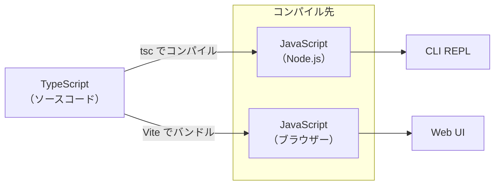

# ADR 0001: 実装言語に TypeScript を採用

- **状態**: 採用
- **日付**: 2026-02-21
- **決定者**: プロジェクトチーム

## 背景

Scheme インタプリタを実装するための言語を選択する必要があります。このインタプリタは Node.js CLI 環境とブラウザーベースの Web UI の両方で使用されます。

## 決定

**TypeScript**（strict モード）を唯一の実装言語として使用する。

## 採用言語の適用範囲

## 根拠

- **型安全性**: Scheme インタプリタは多様なタグ付き共用体の値型（`SchemeVal`）を操作します。TypeScript の判別共用体（`type: "pair" | "null" | ...`）によってコンパイル時の網羅性チェックが可能です。
- **ブラウザー + Node.js の移植性**: TypeScript は標準 JavaScript にコンパイルされ、変更なしで両環境で動作します。
- **エコシステム**: Vite・Vitest・Biome などのリッチなツール群が TypeScript ネイティブです。
- **保守性**: Strict 型付けにより、実行時エラーのクラス全体を防止できます。

## 影響

- ビルドステップが必要（TypeScript → JavaScript）
- インタプリタコアでは TypeScript 固有のランタイム機能は使用不可（移植性の要件）
- TypeScript ESM の慣例に従い、インポートパスには `.js` 拡張子を使用
