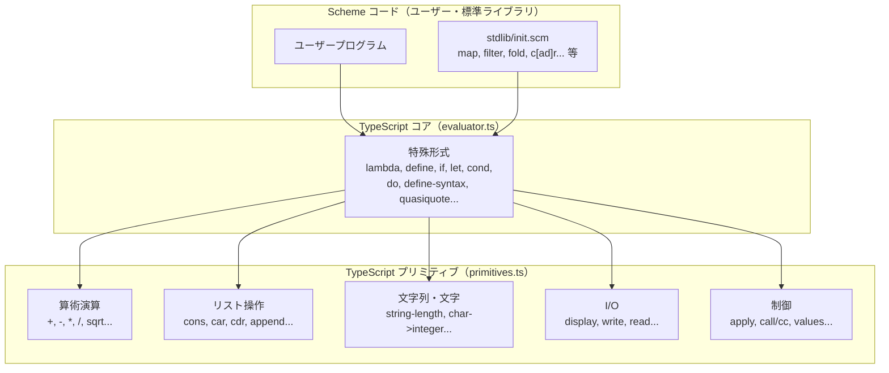
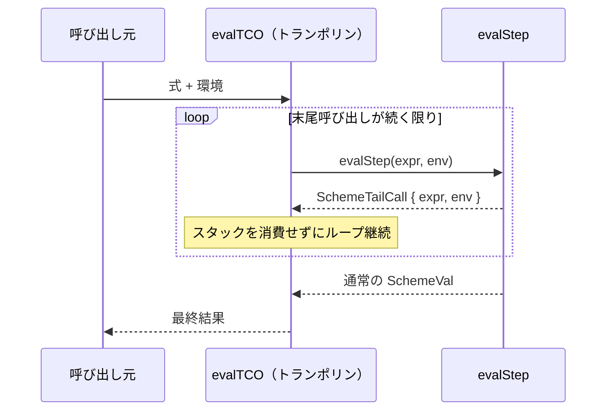
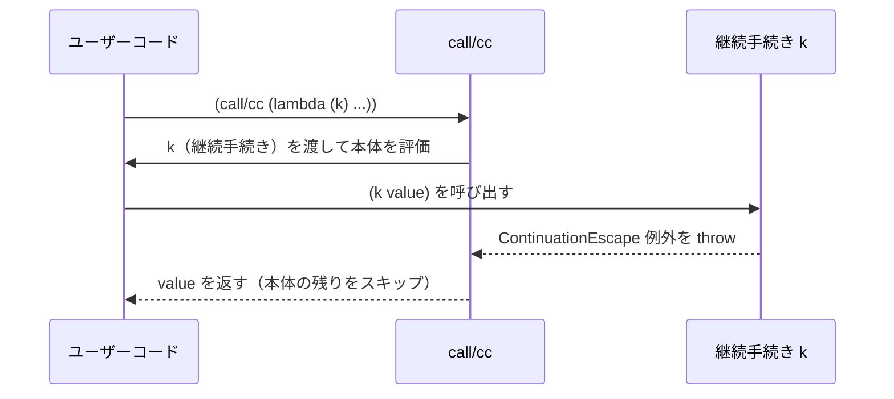

# ADR 0003: R5RS 準拠戦略

- **状態**: 採用
- **日付**: 2026-02-21
- **決定者**: プロジェクトチーム

## 背景

本プロジェクトは R5RS（Revised⁵ Report on the Algorithmic Language Scheme）を対象としています。どの機能を TypeScript で実装し、何を Scheme 自体で実装するかを決定する必要があります。

## 決定

1. **コア特殊形式**は TypeScript で実装（`evaluator.ts`）
2. **低レベルアクセスを要する組み込み手続き**は TypeScript で実装（`primitives.ts`）
3. **高レベルの標準ライブラリ手続き**は Scheme で実装（`stdlib/init.scm`）
4. **末尾呼び出し最適化**はトランポリンパターンで TypeScript 実装

## 実装レイヤー構成

## 根拠

### コアを TypeScript で実装する理由

特殊形式（`lambda`, `define`, `if`, `begin`, `quote`, `set!`, `let`, `cond`, `do`, `define-syntax` 等）は TypeScript で実装する必要があります。これらは評価の順序を制御する必要があり、通常の手続き呼び出しでは表現できないためです。

### 標準ライブラリを Scheme で実装する理由

`map`, `for-each`, `filter`, `fold`, `caar`, `cadr` 等の手続きは、コアさえあれば Scheme で表現できます。これにより:
- コア実装の検証になる（`map` が動けばコアが正しい証明）
- `primitives.ts` を低レベル操作に集中させられる
- 言語の表現力をデモンストレーションできる

### 末尾呼び出し最適化（TCO）

R5RS は適切な末尾呼び出しを必須要件としています。**トランポリン**パターンで実装:

- `evaluate()` は末尾位置で再帰する代わりに `SchemeTailCall` オブジェクトを返す
- 外側のトランポリンループが非末尾結果を得るまでイテレートし続ける
- これにより任意の深さの末尾再帰がスタックオーバーフローなしに動作

### call/cc（エスケープ継続のみ）

完全な `call/cc`（実体化された継続）は複雑で、インタプリタ全体の CPS 変換が必要です。フェーズ 1〜3 では JavaScript の例外機構を使用して**エスケープ継続のみ**を実装します:

- 継続手続きは `ContinuationEscape` 例外を throw する
- `call/cc` のキャッチポイントがこれを捕捉して値を返す
- 早期終了パターンの `call/cc` を正しく処理でき、実用上の大半のユースケースをカバー

完全継続（スタックキャプチャ・リストア）は将来フェーズに延期。

## 影響

- `stdlib/init.scm` はインタプリタ起動時に Node.js コンテキストでは `readFileSync` で、ブラウザーでは文字列としてバンドルして読み込む
- トランポリンは明示的な末尾位置のみ処理し、`eval` と `apply` をまたぐ相互再帰もトランポリン化
- エスケープのみの `call/cc` では、マルチショットまたは上向き継続に依存するプログラムは現バージョンでは正しく動作しない
