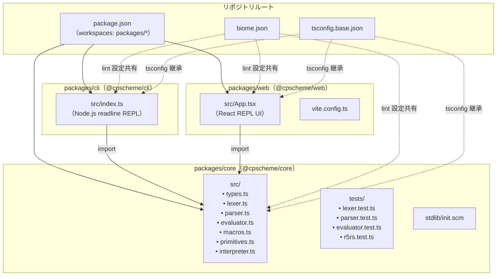
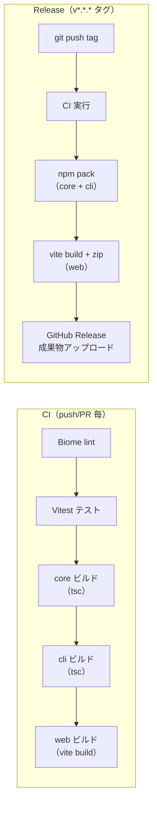

# ADR 0004: npm Workspaces によるモノレポ構成

- **状態**: 採用
- **日付**: 2026-02-21
- **決定者**: プロジェクトチーム

## 背景

プロジェクトには、コアインタプリタライブラリ・CLI ツール・Web アプリケーションという3つの独立したコンポーネントがあります。これらをどのように整理するかを決定する必要があります。

## 決定

**npm workspaces** モノレポで3つのパッケージを管理する:

```
packages/
  core/   — @cpscheme/core（ライブラリ）
  cli/    — @cpscheme/cli （Node.js CLI）
  web/    — @cpscheme/web （Vite + React Web アプリ）
```

## パッケージ構成図



## CI/CD パイプライン



## 根拠

- **コード共有**: `@cpscheme/core` は CLI と Web 両方の単一依存として機能し、コード重複を避けられる
- **独立バージョニング**: 各パッケージは独自のバージョンとリリースサイクルを持てる
- **統合ツール**: ルートの `npm install` 一回で全依存関係をインストール
- **シンプル**: npm workspaces は npm 7+ に標準搭載されており、Lerna・Nx・Turborepo などの追加ツールが不要

## 検討した代替案

| アプローチ | 不採用理由 |
|---|---|
| 単一パッケージ | CLI と Web でインタプリタをクリーンに共有できない |
| Lerna | 3パッケージに対して不要な複雑さ |
| Nx / Turborepo | プロジェクト規模に対してオーバーエンジニアリング |
| 分離リポジトリ | 依存関係管理のオーバーヘッドが発生 |

## 影響

- ルート `package.json` で `"workspaces": ["packages/*"]` を使用
- クロスパッケージのインポートはワークスペースエイリアス（`@cpscheme/core: "*"`）を使用
- Biome 設定と TypeScript 基本設定はルートに置く
- `vitest` は現在 `packages/core` のみ（ユニットテストを持つ唯一のパッケージ）
